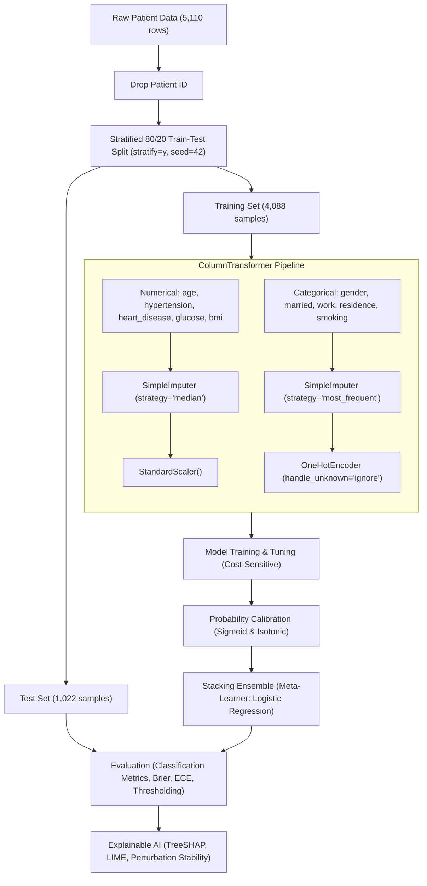

# Explainable AI on Ensemble Methods for Early Neurological Risk Forecasting

> **Disclaimer**: This repository is an academic research prototype developed strictly for exploratory risk forecasting and methodological investigation into model explainability. It is **not** a certified medical device, does **not** provide clinical diagnosis, and must **never** be used as a substitute for professional medical advice, clinical diagnosis, or patient management decisions.

---

## 1. Research Problem

Acute neurological episodes, notably cerebrovascular accidents (stroke), are among the leading causes of chronic adult disability and mortality globally. Early identification of vulnerable individuals using non-invasive, routinely gathered demographic and physiological screening parameters could enable preventive lifestyle and therapeutic interventions before clinical onset.

However, developing machine learning decision-support algorithms for early neurological risk stratification faces three severe technical and clinical obstacles:
1. **Severe Class Imbalance**: In general population cohorts, stroke incident rates are low (typically < 5%), leading conventional algorithms to favor the majority non-stroke class and fail to identify high-risk individuals.
2. **Probability Miscalibration**: Machine learning models—particularly complex tree ensembles—often output raw probabilities that do not reflect true posterior risk likelihoods, which can misinform clinical risk stratification.
3. **The "Black Box" Barrier**: High-performing ensemble models inherently lack transparency. Without verifiable explanations of how individual physiological risk factors influence predictions, clinicians cannot scrutinize or trust model outputs.

---

## 2. Research Objectives

* **Comparative Benchmarking**: Benchmark baseline and modern ensemble machine learning architectures (Logistic Regression, Random Forest, XGBoost, and Stacking Ensembles) on population stroke risk prediction.
* **Class Imbalance Mitigation**: Implement and evaluate cost-sensitive loss weighting strategies to enhance minority-class sensitivity without unacceptable drops in specificity.
* **Post-Hoc Probability Calibration**: Implement and evaluate Platt Scaling (Sigmoid) and Isotonic Regression to ensure predicted risk probabilities align with observed empirical event frequencies.
* **Multi-Level Explainability**: Couple global feature attribution (TreeSHAP) with local patient explanations (SHAP and LIME) to illuminate patient-specific risk profiles.
* **Explanation Stability Quantification**: Measure the mathematical robustness of explanations under slight physiological perturbations to evaluate interpretability trustworthiness.
* **Clinical Decision Threshold Optimization**: Investigate operating thresholds across the probability spectrum to determine optimal operating points for clinical screening scenarios.

---

## 3. Dataset Description

The project utilizes the public **Kaggle Stroke Prediction Dataset** (`healthcare-dataset-stroke-data.csv`), located in the `dataset/` directory.

* **Sample Size**: 5,110 patient records.
* **Target Variable**: `stroke` (Binary classification: `0` = No Stroke, `1` = Stroke).
* **Prevalence / Imbalance**:
  * Negative class (`0`): 4,861 instances (~95.13%)
  * Positive class (`1`): 249 instances (~4.87%)
  * Class ratio: Approximately 19.5:1 negative-to-positive ratio.
* **Feature Schema** (10 predictive features used, patient `id` excluded):
  * **Numerical Features (5)**:
    * `age`: Patient age in years (Range: 0.08 to 82.0).
    * `hypertension`: History of hypertension (`0` = No, `1` = Yes).
    * `heart_disease`: History of cardiovascular disease (`0` = No, `1` = Yes).
    * `avg_glucose_level`: Average blood glucose level in mg/dL.
    * `bmi`: Body Mass Index in kg/m² (contains missing values).
  * **Categorical Features (5)**:
    * `gender`: `Male`, `Female`, `Other`.
    * `ever_married`: `No`, `Yes`.
    * `work_type`: `Private`, `Self-employed`, `Govt_job`, `children`, `Never_worked`.
    * `Residence_type`: `Urban`, `Rural`.
    * `smoking_status`: `formerly smoked`, `never smoked`, `smokes`, `Unknown`.

---

## 4. Machine Learning & Preprocessing Methodology

The pipeline follows rigorous machine learning practices to prevent data leakage and ensure reproducible evaluation:



* **Preprocessing Details**:
  * **Numerical Pipeline**: Missing BMI entries are imputed using training-set medians via `SimpleImputer(strategy="median")`, followed by feature z-score normalization using `StandardScaler()`.
  * **Categorical Pipeline**: Missing categories are imputed using `SimpleImputer(strategy="most_frequent")` and transformed via `OneHotEncoder(handle_unknown="ignore")`.
  * **Leakage Prevention**: All imputation and scaling statistics are fitted strictly on `X_train` and subsequently applied to `X_test`.

---

## 5. Models Implemented

1. **Logistic Regression (Baseline)**: Linear baseline with `class_weight="balanced"` and `max_iter=1000`.
2. **Random Forest (Baseline)**: Bagging ensemble with 300 estimators, `class_weight="balanced"`, and `random_state=42`.
3. **Base XGBoost**: Extreme Gradient Boosting with 300 estimators, `max_depth=4`, `learning_rate=0.05`, `subsample=0.8`, `colsample_bytree=0.8`, and `scale_pos_weight=19.54`.
4. **Tuned XGBoost**: Optimized via 5-fold cross-validated `RandomizedSearchCV` targeting Precision-Recall AUC (PR-AUC).
   * Selected Hyperparameters: `n_estimators=200`, `max_depth=4`, `learning_rate=0.1`, `subsample=1.0`, `colsample_bytree=1.0`, `min_child_weight=5`.
5. **Stacking Ensemble**: Hierarchical meta-learning ensemble architecture:
   * **Base Estimators**: Logistic Regression, Random Forest, Tuned XGBoost.
   * **Meta-Learner**: Logistic Regression (`max_iter=1000`).
   * **Stacking Strategy**: 5-fold cross-validated out-of-fold probability predictions (`stack_method="predict_proba"`).

---

## 6. Class Imbalance Handling & Ablation Study

Due to the ~19.5:1 negative-to-positive ratio, unweighted classifiers achieve high overall accuracy by predicting negative across the cohort, resulting in unacceptable recall/sensitivity for identifying stroke risk.

To address this, cost-sensitive learning was introduced:
* **Logistic Regression & Random Forest**: `class_weight="balanced"`.
* **XGBoost**: `scale_pos_weight=19.54` (computed as $\frac{N_{\text{negative}}}{N_{\text{positive}}}$).

### Experimental Ablation Results on XGBoost:

| Experiment Configuration | Accuracy | Precision | Sensitivity (Recall) | Specificity | F1-Score | ROC-AUC | PR-AUC | MCC | Brier Score | ECE |
| :--- | :---: | :---: | :---: | :---: | :---: | :---: | :---: | :---: | :---: | :---: |
| **XGBoost (No Imbalance Handling)** | 0.9491 | 0.4000 | 0.0800 | 0.9938 | 0.1333 | 0.8190 | 0.2084 | 0.1601 | 0.0438 | 0.0327 |
| **XGBoost (With Imbalance Handling)** | 0.8640 | 0.1799 | 0.5000 | 0.8827 | 0.2646 | 0.8185 | 0.2143 | 0.2408 | 0.0908 | 0.1270 |

*Key Finding*: Handling class imbalance dramatically elevated stroke sensitivity from **8.0% to 50.0%**, more than doubling the F1-Score (0.1333 to 0.2646) and substantially improving the Matthews Correlation Coefficient (0.1601 to 0.2408).

---

## 7. Probability Calibration

Medical risk forecasting requires reliable predicted probabilities that correspond to actual empirical risk. While tree-based models and class-weighted estimators provide strong ranking capabilities (ROC-AUC), they often distort raw posterior probabilities.

Both **Platt Scaling (Sigmoid)** and **Isotonic Regression** were evaluated using 5-fold cross-validation (`CalibratedClassifierCV(cv=5)`):

### Experimental Calibration Results:

| Model | Calibration Method | Brier Score (Lower is Better) | Expected Calibration Error (ECE) | ROC-AUC | PR-AUC |
| :--- | :--- | :---: | :---: | :---: | :---: |
| **Logistic Regression** | Base | 0.1677 | 0.2694 | 0.8437 | 0.2685 |
| | Sigmoid | 0.0408 | 0.0131 | 0.8435 | 0.2687 |
| | Isotonic | 0.0409 | 0.0056 | 0.8394 | 0.2797 |
| **Random Forest** | Base | 0.0552 | 0.0455 | 0.7792 | 0.1360 |
| | Sigmoid | 0.0449 | 0.0099 | 0.7971 | 0.1468 |
| | Isotonic | 0.0439 | 0.0053 | 0.7955 | 0.1474 |
| **XGBoost** | Base | 0.0908 | 0.1270 | 0.8185 | 0.2143 |
| | Sigmoid | 0.0423 | 0.0066 | 0.8261 | 0.2185 |
| | Isotonic | 0.0420 | 0.0081 | 0.8233 | 0.2367 |

*Key Finding*: Post-hoc calibration reduced the Expected Calibration Error (ECE) across all models (e.g., XGBoost ECE dropped from **0.1270 to 0.0066** under Sigmoid calibration), ensuring that risk probabilities can be meaningfully interpreted.

---

## 8. Explainable AI (XAI) Framework

To satisfy the transparency requirements of clinical research, a multi-tier interpretability framework was implemented:

```
Explainable AI Framework
├── 1. Global Interpretability (TreeSHAP)
│   ├── Mean Absolute SHAP Ranking (age, avg_glucose_level, bmi as top factors)
│   └── Summary Beeswarm & Bar Visualizations
├── 2. Local Patient Attribution
│   ├── SHAP Local Waterfall / Directional Attribution
│   └── LIME Local Surrogate Weighting (LimeTabularExplainer)
├── 3. Explanation Cross-Validation
│   └── Concordance Analysis between SHAP and LIME Attributions
└── 4. Explanation Stability & Robustness
    └── Cosine Similarity & Absolute Shift Under Input Perturbations
```

### 1. Global Interpretability (TreeSHAP)
Global feature importances extracted via `shap.TreeExplainer` on the gradient boosted model revealed that patient **age**, **average blood glucose level**, and **body mass index (BMI)** are the dominant physiological drivers of predicted stroke risk.

### 2. Local Patient Interpretability (SHAP & LIME)
For individual test patient instances, both SHAP values and LIME linear surrogate coefficients (`LimeTabularExplainer`) are computed, identifying which specific factors elevate risk (e.g., advanced age, elevated blood glucose) versus which features lower risk (e.g., lack of hypertension history).

### 3. Explanation Stability Evaluation
To evaluate whether explanations are robust against minor physiological fluctuations or measurement noise, 6 distinct perturbations were tested on a reference patient:
* Age $\pm 1$ year
* BMI $\pm 1$ unit
* Average Glucose $\pm 5$ mg/dL

The cosine similarity and mean absolute difference between original and perturbed SHAP vectors were computed:

| Perturbation | Perturbed Probability | SHAP Cosine Similarity | Mean Absolute SHAP Difference |
| :--- | :---: | :---: | :---: |
| **Age +1 year** | 0.1187 | 0.9955 | 0.0136 |
| **Age -1 year** | 0.1125 | 0.9924 | 0.0206 |
| **BMI +1** | 0.1743 | 0.9861 | 0.0271 |
| **BMI -1** | 0.2359 | 0.9388 | 0.0508 |
| **Glucose +5** | 0.0719 | 0.9231 | 0.0500 |
| **Glucose -5** | 0.1382 | 0.9958 | 0.0187 |
| **Overall Average** | — | **0.9720** | **0.0301** |

*Key Finding*: The high average cosine similarity (**0.9720**) demonstrates that local TreeSHAP explanations exhibit robust mathematical stability under minor input shifts.

---

## 9. Comprehensive Model Comparison

The experimentally measured performance on the held-out test cohort ($N = 1,022$) across all models is summarized below (from `results/master_model_results.csv`):

| Model Architecture | Accuracy | Precision | Sensitivity (Recall) | Specificity | F1-Score | ROC-AUC | PR-AUC | MCC | Brier Score | ECE |
| :--- | :---: | :---: | :---: | :---: | :---: | :---: | :---: | :---: | :---: | :---: |
| **Logistic Regression (Baseline)** | 0.7456 | 0.1379 | 0.8000 | 0.7428 | 0.2353 | 0.8437 | 0.2685 | 0.2597 | 0.1677 | 0.2694 |
| **Random Forest (Baseline)** | 0.9354 | 0.2143 | 0.1200 | 0.9774 | 0.1538 | 0.7792 | 0.1360 | 0.1287 | 0.0552 | 0.0455 |
| **XGBoost (Imbalance Handled)** | 0.8640 | 0.1799 | 0.5000 | 0.8827 | 0.2646 | 0.8185 | 0.2143 | 0.2408 | 0.0908 | 0.1270 |
| **Tuned XGBoost** | 0.8885 | 0.2193 | 0.5000 | 0.9084 | 0.3049 | 0.8129 | 0.2176 | 0.2799 | 0.0817 | — |
| **Stacking Ensemble (Threshold = 0.50)** | 0.9511 | 0.0000 | 0.0000 | 1.0000 | 0.0000 | **0.8481** | **0.2633** | 0.0000 | **0.0405** | — |

---

## 10. Clinical Decision Threshold Analysis

Because the Stacking Ensemble predicts low calibrated probabilities for the minority class, evaluating at the conventional decision threshold of **0.50 causes threshold collapse** (predicting negative for all patients, yielding 0.0 sensitivity). 

A threshold sweep was conducted across the probability range $[0.05, 0.50]$ on the held-out test set:

| Threshold | Accuracy | Precision | Sensitivity | Specificity | F1-Score | MCC | True Positives (TP) | False Positives (FP) | False Negatives (FN) | True Negatives (TN) |
| :---: | :---: | :---: | :---: | :---: | :---: | :---: | :---: | :---: | :---: | :---: |
| **0.05** | 0.7554 | 0.1454 | **0.8200** | 0.7521 | 0.2470 | 0.2761 | 41 | 241 | 9 | 731 |
| **0.10** | 0.8552 | 0.2118 | **0.7200** | 0.8621 | 0.3273 | **0.3372** | 36 | 134 | 14 | 838 |
| **0.15** | 0.9061 | 0.2700 | **0.5400** | 0.9249 | **0.3600** | **0.3375** | 27 | 73 | 23 | 899 |
| **0.20** | 0.9344 | 0.3455 | 0.3800 | 0.9630 | **0.3619** | 0.3278 | 19 | 36 | 31 | 936 |
| **0.25** | 0.9481 | 0.4400 | 0.2200 | 0.9856 | 0.2933 | 0.2871 | 11 | 14 | 39 | 958 |
| **0.30** | 0.9481 | 0.2857 | 0.0400 | 0.9949 | 0.0702 | 0.0912 | 2 | 5 | 48 | 967 |
| **$\ge 0.35$** | 0.9511 | 0.0000 | 0.0000 | 1.0000 | 0.0000 | 0.0000 | 0 | 0 | 50 | 972 |

### Clinical Recommendation:
* **High-Sensitivity Screening Setting (Threshold = 0.05 - 0.10)**: Recommended when the priority is early flag capture (Sensitivity: 72%–82%, Specificity: 75%–86%).
* **Balanced Clinical Trade-off (Threshold = 0.15)**: Yields the highest combined Matthews Correlation Coefficient (**0.3375**) and F1-score (**0.3600**) with 54% sensitivity and 92.5% specificity.

---

## 11. Existing Project Structure

```
D:\Neurological_Risk_Forecasting\
├── .gitignore                               # Git ignore configuration
├── README.md                                # Project research documentation
├── requirements.txt                         # Python dependencies
├── backend/                                 # [Phase 4] FastAPI REST service
├── dataset/
│   └── healthcare-dataset-stroke-data.csv   # Kaggle Stroke Dataset (5,110 rows)
├── explainability/                          # [Phase 3] Modular XAI package
├── models/                                  # [Phase 2] Serialized trained pipelines (.joblib)
├── results/                                 # Generated research figures and metrics
│   ├── actual_precision_recall_curve.png
│   ├── actual_roc_curve.png
│   ├── calibrated_calibration_curves.png
│   ├── explanation_stability.png
│   ├── final_shap_lime_comparison.png
│   ├── master_model_results.csv
│   ├── master_calibration_results.csv
│   ├── master_threshold_results.csv
│   └── ... (additional experimental plots and CSV tables)
├── src/                                     # Research & experimentation scripts
│   ├── load_data.py                         # Data inspection and BMI cleaning
│   ├── train_models.py                      # Baseline models benchmarking
│   ├── calibration.py                       # Initial reliability curves
│   ├── calibrate_models.py                  # Sigmoid & Isotonic calibration
│   ├── shap_global.py                       # Global TreeSHAP feature importances
│   ├── shap_local.py                        # Local patient SHAP explanations
│   ├── lime_local.py                        # Local patient LIME explanations
│   ├── explanation_stability.py             # Perturbation stability analysis
│   ├── ablation_study.py                    # Imbalance weighting ablation
│   ├── hyperparameter_tuning.py             # RandomizedSearchCV for XGBoost
│   ├── ensemble_model.py                    # StackingClassifier implementation
│   ├── ensemble_threshold_analysis.py       # Threshold sweep (0.05 - 0.50)
│   ├── create_master_results.py             # Compiles master summary tables
│   ├── generate_final_figures.py            # Generates publication comparison plots
│   └── generate_actual_roc_pr.py            # Generates empirical ROC and PR curves
└── venv/                                    # Python virtual environment
```

---

## 12. Environment Setup & Execution Guide

### Activating the Virtual Environment (Windows)

Open a terminal in the project root directory (`D:\Neurological_Risk_Forecasting`):

* **PowerShell**:
  ```powershell
  .\venv\Scripts\Activate.ps1
  ```
  *(If script execution is disabled on your system, run: `Set-ExecutionPolicy -ExecutionPolicy RemoteSigned -Scope Process` first)*

* **Command Prompt (CMD)**:
  ```cmd
  .\venv\Scripts\activate.bat
  ```

* **Verify Environment**:
  ```bash
  python -V
  pip list
  ```

---

### Running the Existing Experiments

All scripts are executed from the project root directory:

```bash
# 1. Train baseline models (Logistic Regression, Random Forest, XGBoost)
python src/train_models.py

# 2. Perform ablation on class imbalance handling
python src/ablation_study.py

# 3. Perform hyperparameter tuning on XGBoost
python src/hyperparameter_tuning.py

# 4. Train the Stacking Ensemble
python src/ensemble_model.py

# 5. Run probability calibration (Sigmoid vs Isotonic)
python src/calibrate_models.py

# 6. Run clinical decision threshold analysis
python src/ensemble_threshold_analysis.py

# 7. Generate global and local SHAP explanations
python src/shap_global.py
python src/shap_local.py

# 8. Generate local LIME explanations
python src/lime_local.py

# 9. Evaluate explanation perturbation stability
python src/explanation_stability.py

# 10. Generate research figures and empirical ROC/PR curves
python src/generate_actual_roc_pr.py
python src/generate_final_figures.py
```

All metric tables and figure PNGs will be refreshed in the [`results/`](file:///D:/Neurological_Risk_Forecasting/results) directory.

---

### Running the Future Backend and Frontend Services

*(Planned for Phase 4 & Phase 5)*

* **Backend REST API (FastAPI)**:
  ```bash
  uvicorn backend.main:app --host 127.0.0.1 --port 8000 --reload
  ```
  API interactive documentation will be available at: `http://127.0.0.1:8000/docs`.

* **Frontend Interactive Dashboard (Streamlit)**:
  ```bash
  streamlit run frontend/app.py
  ```
  The interactive user interface will open in your default browser at: `http://localhost:8501`.

---

## 13. Research Limitations

1. **Retrospective Cross-Sectional Data**: The dataset represents static, retrospective patient observations and lacks longitudinal follow-up, disease progression tracking, or physiological trajectories over time.
2. **Absence of High-Resolution Biomarkers**: Routine screening parameters (age, glucose, BMI) do not include vital neurological indicators such as detailed lipid sub-fractions, continuous blood pressure monitoring, carotid ultrasound, or neuroimaging (CT/MRI).
3. **Single-Source Population**: Data originated from a single public dataset repository without geographic or multi-institutional clinical diversity, meaning findings may not generalize across different hospital populations.
4. **Ensemble Explanation Overhead**: Local explanations for the Stacking Ensemble rely on surrogate tree explanations (XGBoost) rather than full black-box ensemble explanations (e.g., KernelSHAP), due to the heavy computational overhead of multi-model permutation.

---

## 14. Future Work

* **Phase 2 Modularization**: Refactor duplicated data handling into reusable modules (`src/data_pipeline.py`) and persist production-ready pipelines to `models/` using `joblib`.
* **Phase 3 Unified XAI Package**: Encapsulate SHAP, LIME, and perturbation tests into callable utility functions in `explainability/`.
* **Phase 4 & 5 Deployment**: Implement the FastAPI backend service and Streamlit interactive web dashboard for real-time patient risk profiling.
* **External Clinical Validation**: Benchmark the pipeline on external electronic health record (EHR) cohorts (such as MIMIC or eICU).
* **Multi-Modal Expansion**: Integrate clinical notes and imaging modalities to transition from screening-level forecasting to multi-modal clinical decision support.
